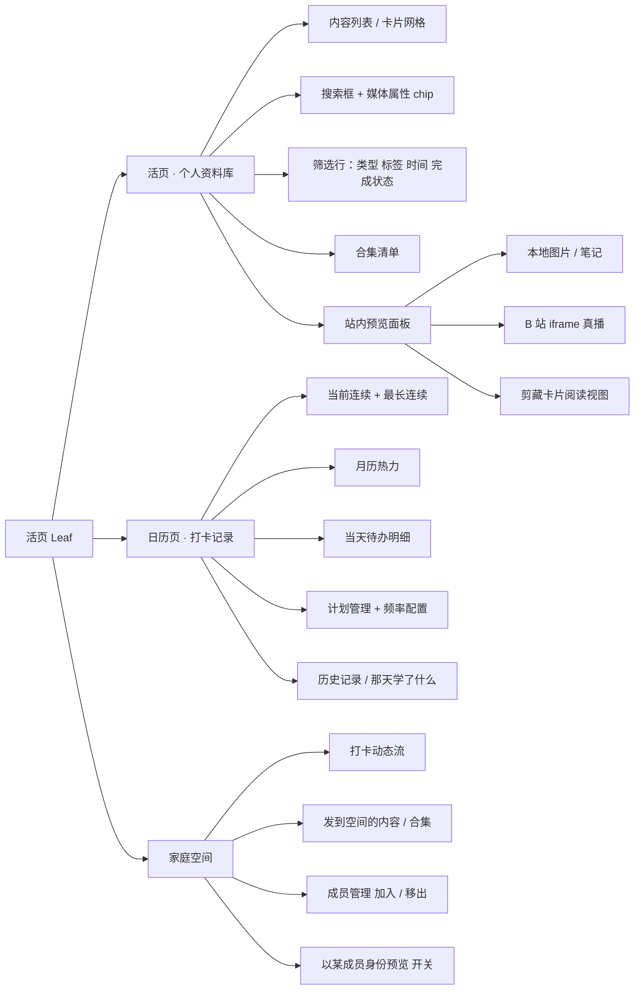
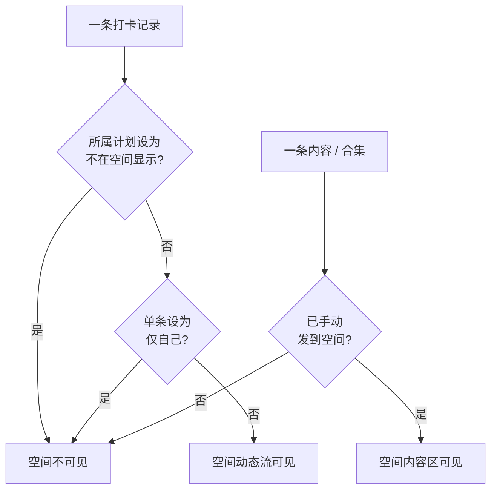

# 活页 / Leaf — 产品需求文档（简单 PRD v1.0）

> 状态：需求定稿（主理人已完成 12 轮拷问，6 个决策分支全部收敛）
> 本轮交付：**可交互原型**。本文档只定义「做什么」，不定义「怎么实现」，不含竞品与市场分析。

---

## 一、项目信息

| 项 | 内容 |
| --- | --- |
| Language | 简体中文 |
| Project Name | `huoye_leaf`（snake_case） |
| 上架建议名 | 活页 · 成长资料库与打卡 |
| Programming Language / 技术栈 | Vite + React + MUI + Tailwind CSS（默认，由架构师最终确认） |
| 交付形态 | Web App / PWA 可交互原型；**纯前端 + 浏览器本地存储** |
| 数据与边界 | 不接后端、不接账号体系、数据不出浏览器 |
| 响应式 | 窄屏底部 3 tab；宽屏（≥1024px）左侧固定导航 + 内容区 + 右侧预览面板；**一套代码** |

**原始需求复述**：集中汇总个人成长内容（健身 / 学习 / 爱好的视频、图片、笔记），按类型、标签、时间、完成状态分类筛选，提供预览与搜索；提供打卡功能，按日或按计划记录完成状态、连续天数与历史记录；支持把内容 / 合集 / 打卡记录共享给多人查看。补充诉求：小红书笔记、B 站视频通过链接索引，**希望 App 内可以直接打开，不用来回跳转**。最终收敛：**目前只是想我和家人可以在一个空间内，可以相互看到打卡了什么**。

---

## 二、产品定义

### 2.1 产品目标（3 个正交目标）

| # | 目标 | 可衡量标准 |
| --- | --- | --- |
| G1 | **一处收纳、站内可读** | 散落在 B 站、小红书、本地的资料统一进入「活页」；B 站视频站内真播、剪藏卡片站内阅读、本地文件站内预览，链路中不出现强制跳转原站 |
| G2 | **坚持有据可查** | 用统一「计划」模型沉淀完成状态、连续天数、历史记录；连续天数按应完成日计算，休息日不中断；可从日历反查「那天学了什么」 |
| G3 | **一个空间、家人共见** | 单个家庭空间内打卡默认公开形成动态流，家人互相可见并给「加油」；隐私仅保留两级隐藏，资料库默认私有；切换成员身份可实时验证可见性规则 |

### 2.2 用户故事

| # | 用户故事 |
| --- | --- |
| US1 | As 一个自建资料库的用户，我想把 B 站视频、小红书笔记、本地图片与笔记收进活页，并按类型 / 标签 / 时间 / 完成状态筛选和全字段搜索，**以便**快速找到要看的内容且不用跳原站。 |
| US2 | As 一个坚持训练与学习的人，我想按每日或自定义频率的计划打卡，看到当前与最长连续天数、月历热力与历史记录，**以便**掌握自己的节奏且休息日不误伤连续记录。 |
| US3 | As 一个家庭空间成员，我想在空间里看到家人今天打卡了什么、并点一个「加油」，**以便**互相督促而不必另发消息。 |
| US4 | As 一个注重隐私的成员，我想把某条打卡设「仅自己」、把某个计划设「不在空间显示」、并让资料库默认私有，**以便**只分享我愿意分享的部分。 |
| US5 | As 验收者 / 用户，我想切换成某位家人的身份预览空间，**以便**确认共享可见性规则是真的生效，而不是只写在说明里。 |

---

## 三、需求池（P0 / P1 / P2）

> P0 = Must have（本版必须可演示）；P1 = Should have（本版尽量覆盖）；P2 = Nice to have（**本版不承诺**，仅记录想法）。

### 3.1 框架与数据

| 编号 | 需求 | 优先级 | 验收要点 |
| --- | --- | --- | --- |
| F-1 | 响应式双形态：窄屏底部 3 tab（活页 / 日历页 / 家庭空间）；宽屏 ≥1024px 左侧固定导航 + 中间内容区 + 右侧常驻预览面板 | P0 | 同一份代码按视口切换，窄宽屏均可完成三大模块主链路 |
| F-2 | 浏览器本地存储，刷新后数据不丢 | P0 | 新增内容 / 打卡 / 成员后刷新仍存在 |
| F-3 | 预置示例数据：含可播 B 站示例、剪藏卡片示例、本地图片、笔记、多个成员与约一个月打卡历史 | P0 | 首次打开无需录入即可演示三大模块与站内预览 |
| F-4 | 数据结构预留「多空间」与「细粒度权限」扩展位，本版不实现对应 UI | P0 | 数据模型中存在扩展字段，UI 无入口 |

### 3.2 模块 A：个人资料库（活页）

| 编号 | 需求 | 优先级 | 验收要点 |
| --- | --- | --- | --- |
| A-1 | 内容条目字段：标题、封面、来源链接、备注、领域类型、媒体属性、标签、收录时间、内容日期、完成状态、所属合集（可多）、关联计划 | P0 | 新建 / 编辑 / 详情可读写全部字段 |
| A-2 | 「类型」= 领域（健身 / 学习 / 爱好）；视频 / 图片 / 笔记为导入时识别的**固有属性**，用顶部 chip 快捷切换，不占主筛选维度 | P0 | chip 切换只做视图过滤，不与领域筛选串联成主维度 |
| A-3 | 多条件 AND 筛选：类型 × 标签 × 时间 × 完成状态（未开始 / 进行中 / 已完成）；**收录时间为主轴与默认排序** | P0 | 多条件同时生效为交集；默认列表按收录时间倒序；已选条件可单独清除 |
| A-4 | 本地全字段搜索：标题 / 备注 / 标签 / 合集名 / 剪藏与笔记正文 | P0 | 输入正文中的词也能命中剪藏卡片与笔记 |
| A-5 | 合集：有序清单、内容可多归属、无嵌套、显示「第 3 / 12 条」进度 | P0 | 一条内容可属于多个合集；合集内可见序号进度 |
| A-6 | **两套独立状态**：内容完成状态与打卡完成状态互不自动同步，允许关联跳转 | P0 | 改动任一状态，另一状态数值不变 |
| A-7 | 小文件（图片、笔记）真实上传存浏览器本地库，并在站内预览打开 | P0 | 上传后可在预览面板直接看到，不触发外部跳转 |
| A-8 | B 站链接用官方 iframe `player.bilibili.com/player.html?bvid=...` 站内真播；受「UP 主允许嵌入 / 公开视频 / HTTPS / 防盗链」限制，**失败自动降级为封面卡** | P0 | 可播示例站内播放成功；不可播链接显示封面卡而非空白 |
| A-9 | 小红书等无嵌入接口的来源生成「剪藏卡片」（标题 / 封面 / 正文 / 图集 / 来源署名），在活页自己的阅读视图打开，**不跳原站** | P0 | 点击剪藏卡片在站内阅读视图展示，原站链接仅作兜底按钮 |
| A-10 | 纯前端无后端受 CORS 限制：剪藏正文靠用户粘贴或预置示例，**不做自动抓取** | P0 | 无抓取逻辑、无抓取失败态 |
| A-11 | 领域类型可自定义增删 | P1 | 可新增 / 删除领域并用于筛选 |
| A-12 | 合集内条目可拖动排序 | P1 | 拖动后顺序持久化 |
| A-13 | 内容日期作为可补录元数据（**不参与主排序**） | P1 | 可编辑，但列表默认排序仍按收录时间 |
| A-14 | 降级封面卡 / 剪藏卡片提供「去原站」兜底按钮 | P1 | 仅用户主动点击才跳外站 |
| A-15 | 剪藏卡片正文与图集可由用户粘贴 / 编辑 | P1 | 编辑后站内阅读视图即时更新 |
| A-16 | 封面自定义上传、搜索结果关键词高亮 | P2 | 本版不承诺 |

### 3.3 模块 B：打卡记录（日历页）

| 编号 | 需求 | 优先级 | 验收要点 |
| --- | --- | --- | --- |
| B-1 | 统一「计划」模型：频率（每天 / 每周 N 次 / 指定星期 / 自定义日期），按频率生成每日待办；「按日」= 每日频率的计划；另留不属于任何计划的「临时记录」 | P0 | 配置频率后日历自动出现对应排期日的待办；可新增无计划归属的临时记录 |
| B-2 | 打卡条目三态：未完成 / 已完成 / 请假；可关联内容或合集（**仅跳转，不联动状态**） | P0 | 三态可切换；点击关联内容跳到预览，内容完成状态不变 |
| B-3 | 连续天数按「**应完成日**」计算：只在计划排期日计数，休息日不中断；漏一个应完成日则当前连续清零；支持 7 天内补卡；提前请假不中断也不计入 | P0 | 休息日不打断连续；漏一个排期日归零；超 7 天不可补；请假既不中断也不加连续 |
| B-4 | 展示：当前连续 + 最长连续、月历热力 + 当天明细列表、历史记录 | P0 | 点击某日显示该日全部待办与状态；热力区分已完成 / 请假 / 未完成 / 非排期日 |
| B-5 | 「那天学了什么」：由日历页经内容 ↔ 计划关联反查 | P0 | 选中历史日期可看到关联的内容 / 合集清单 |
| B-6 | 打卡可带时长与备注 | P1 | 可录入并在明细与动态流展示 |
| B-7 | 周 / 月热力视图切换、历史记录按计划筛选 | P2 | 本版不承诺 |

### 3.4 模块 C：家庭空间

> ⚠️ **不做细粒度权限体系**。用户明确只要「我和家人在一个空间内，互相看到打卡了什么」；早先的三级访问权限 + 对象 / 时间 / 字段三维范围裁剪模型**已作废**。

| 编号 | 需求 | 优先级 | 验收要点 |
| --- | --- | --- | --- |
| C-1 | 只有**一个**家庭空间；成员为模拟身份（可增删、可切换身份视角预览、可替家人补打卡），只做加入 / 移出 | P0 | 成员增删即时反映；无多空间入口 |
| C-2 | **必须提供「以某位成员身份预览」开关，可见性规则真实生效** | P0 | 切换身份后动态流与空间内容按该成员实时重算，结果确有差异 |
| C-3 | 打卡**默认对空间公开**，形成动态流 | P0 | 新建打卡自动出现在动态流，无需额外发布动作 |
| C-4 | 两级隐藏：单条打卡「仅自己」、整个计划「不在空间显示」；**不做全局隐身** | P0 | 两种隐藏均生效；无全局隐身开关 |
| C-5 | 个人资料库默认私有；内容 / 合集需手动「发到空间」才可见 | P0 | 未发布的内容在其他成员视角不可见 |
| C-6 | 空间内轻量「加油」反应；不做评论串、消息通知 | P0 | 可点赞 / 加油；无评论输入框与通知中心 |
| C-7 | 替家人补打卡 | P1 | 以当前身份为指定成员补录，计入该成员记录 |
| C-8 | 空间动态流按成员筛选、加油数展示 | P2 | 本版不承诺 |

---

## 四、UI 设计稿（文字版）

### 4.1 信息架构

### 4.2 响应式布局

| 视口 | 结构 | 预览承载方式 |
| --- | --- | --- |
| 窄屏（<1024px，手机） | 顶部标题栏 + 内容区 + **底部固定 3 tab**：活页 / 日历页 / 家庭空间 | 选中条目后以全屏页或底部抽屉打开预览 |
| 宽屏（≥1024px） | **左侧固定导航（3 项）+ 中间内容区 + 右侧常驻预览面板** | 右侧面板常驻，选中条目即预览，不跳页 |

> 一套代码实现：布局与预览容器按断点条件渲染，业务组件复用。

### 4.3 三大模块页面结构

#### 模块 A：活页（个人资料库）

| 区域 | 元素 | 说明 |
| --- | --- | --- |
| 顶部 | 全字段搜索框、媒体属性 chip（全部 / 视频 / 图片 / 笔记） | chip 只切视图，不占主筛选维度 |
| 筛选行 | 类型（领域）、标签、时间（收录时间）、完成状态 | 多条件 AND，已选条件可单个清除；默认按收录时间倒序 |
| 主体 | 内容卡片网格 | 封面、标题、领域 chip、标签、收录时间、完成状态、合集进度角标 |
| 宽屏右侧 | 站内预览面板 | 依来源自动选择：本地文件 / B 站 iframe / 剪藏阅读视图 / 降级封面卡 |
| 二级页 | 合集清单 | 有序条目、拖动排序、「第 3 / 12 条」进度 |

**关键交互**：新增内容（手动录入 / 粘贴链接 / 上传本地文件，链接自动识别来源类型：B 站 → iframe，其他 → 剪藏卡片）；完成状态手动切换且不写入打卡；关联计划仅跳转；「发到空间」手动发布；嵌入失败自动降级封面卡 + 兜底外链按钮。

#### 模块 B：日历页（打卡记录）

| 区域 | 元素 | 说明 |
| --- | --- | --- |
| 顶部 | 当前连续 / 最长连续 两张数字卡 | 按应完成日口径 |
| 月历热力 | 按日着色 | 区分已完成 / 请假 / 未完成 / 非排期日；休息日不中断连续 |
| 当天明细 | 选中日期的待办列表 | 由计划频率生成 + 临时记录；三态切换、时长备注、关联内容跳转 |
| 二级页 | 计划管理 | 频率配置（每天 / 每周 N 次 / 指定星期 / 自定义日期）、「不在空间显示」开关 |
| 二级页 | 历史记录 | 列表 + 「那天学了什么」内容 ↔ 计划反查 |

**关键交互**：点击某日 → 明细；三态打卡；7 天内补卡入口；提前请假；关联内容 / 合集只跳转不改状态；计划级可见性开关。

#### 模块 C：家庭空间

| 区域 | 元素 | 说明 |
| --- | --- | --- |
| 顶部 | 空间名、成员头像条、**「以…身份预览」开关（必显）** | 切换身份后全页可见性实时重算 |
| 动态流 | 打卡卡片 | 成员、计划、内容、时间、时长备注、「加油」按钮；默认公开，隐藏项不出现 |
| 空间内容区 | 手动「发到空间」的内容 / 合集 | 资料库默认私有，未发布不可见 |
| 二级页 | 成员管理 | 模拟身份加入 / 移出；替家人补打卡 |

**关键交互**：切换身份 → 动态流与内容区按规则重算（用于验收）；单条打卡设「仅自己」；计划设「不在空间显示」；内容 / 合集「发到空间」与「从空间移除」；「加油」。

### 4.4 关键交互规则（供架构师直接落地）

| 规则 | 定义 |
| --- | --- |
| 两套状态 | 内容完成状态与打卡完成状态为独立字段，任一变更不自动写另一；仅在关联处提供手动跳转 |
| 来源识别 | B 站链接 → 提取 bvid → 官方 iframe 站内真播；无嵌入接口来源 → 生成剪藏卡片 → 站内阅读视图；本地小文件 → 上传 + 站内预览 |
| 降级 | B 站嵌入失败自动降级封面卡；外链仅作兜底按钮，不作为默认路径；不做自动抓取 |
| 连续天数 | 仅应完成日计数；休息日不中断；漏一个应完成日当前连续清零；提前请假不中断也不计入；补卡窗口 7 天 |
| 空间可见性 | 打卡默认公开；「仅自己」优先于「不在空间显示」；资料库默认私有、仅手动发布可见；无全局隐身 |
| 身份预览 | 切换成员后所有可见性按该成员重算，用于验证规则真实生效 |

---

## 五、边界：本版明确不做

- 真多人跨设备同步、账号体系、后端服务、公网可访问的共享链接
- 大视频网盘式存储（本地仅存图片 / 笔记等小文件）
- 自动抓取小红书正文（CORS 限制，原型靠用户粘贴或预置示例）
- 评论串与消息通知
- 全局隐身开关
- 细粒度权限 UI（三级访问权限 + 对象 / 时间 / 字段三维范围裁剪模型**已作废**，仅数据结构预留扩展位）
- 竞品分析 / 市场调研（用户未要求）

---

## 六、待确认问题（Open Questions）

> 以下问题**均为原型实现细节，不改动已收敛的产品决策**。未获答复时按「建议默认值」执行，不阻塞架构与开发。

| # | 问题 | 建议默认值 |
| --- | --- | --- |
| Q1 | 本地存储选型：localStorage（约 5MB，简单）vs IndexedDB（可存图片 Blob、容量大）？图片需真实上传 | 采用 IndexedDB 或等价方案，保证图片可存 |
| Q2 | B 站链接识别范围：完整 URL / 纯 BV 号 / 短链？原型是否只支持含 `BV` 的链接正则提取 | 仅支持完整 URL 与纯 BV 号，不做短链解析 |
| Q3 | 剪藏卡片图集：用户粘贴的是本地上传图片还是外链 URL？外链图片可能受防盗链 / CORS 影响 | 走本地上传；外链图片仅预置示例使用 |
| Q4 | 「每周 N 次」的排期日口径：由用户指定具体星期，还是周内任意 N 日达成即可？会影响连续天数计算 | 由用户在计划内指定候选星期，按指定日排期 |
| Q5 | 「替家人补打卡」是否同样受 7 天补卡窗口限制、是否计入该成员连续天数 | 是，与本人补卡同规则 |
| Q6 | 预置示例数据规模是否合适 | 建议 8–12 条内容（覆盖 B 站可播 / 剪藏 / 图片 / 笔记）+ 3 名成员 + 2–3 个计划 + 约 30 天打卡历史 |
| Q7 | 「加油」是否去重、是否可取消 | 同一成员对同一条打卡仅一次，可取消 |
| Q8 | 内容 ↔ 计划是否双向反查（内容详情也能看到关联计划打卡情况） | 仅日历页单向反查，内容侧只提供跳转 |
| Q9 | PWA 是否需要可安装（manifest + service worker），还是响应式 Web 即可 | 本版响应式 Web 即可，预留 PWA 能力但不强制安装 |
