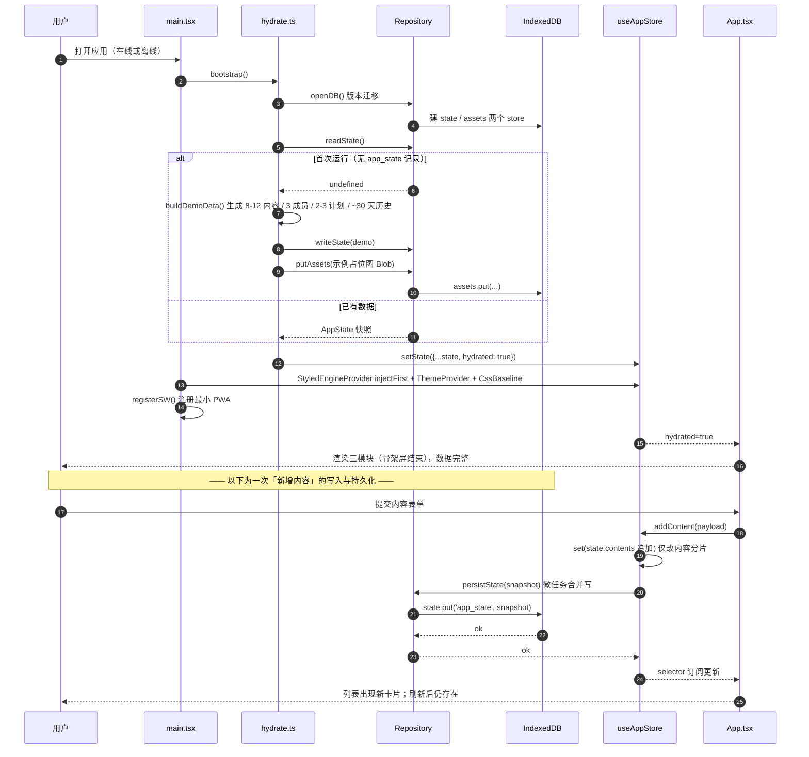
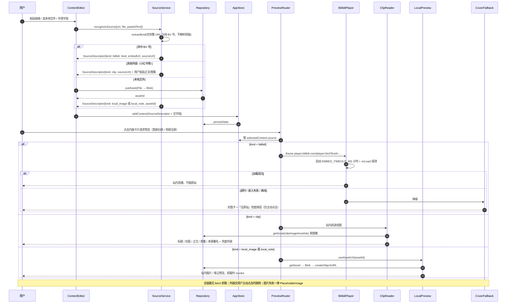
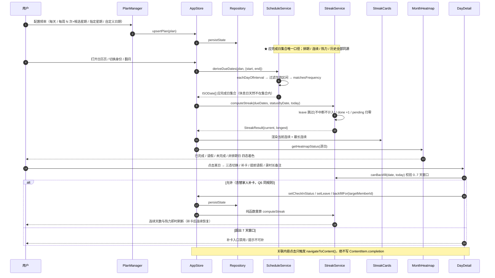
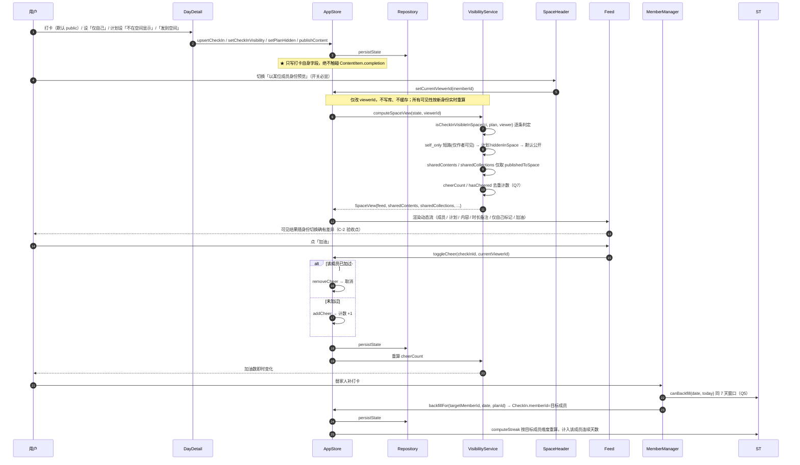
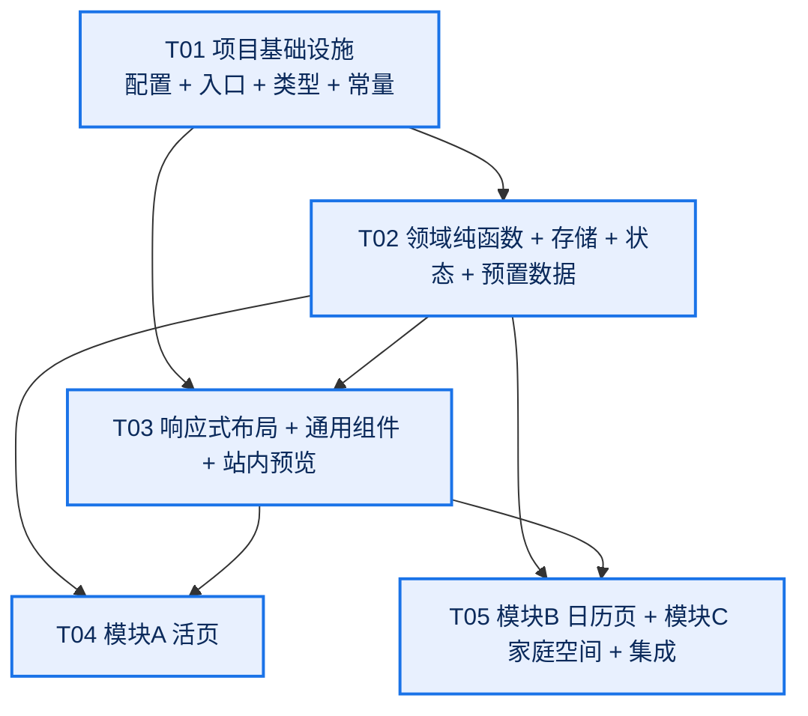

# 活页 / Leaf — 系统架构设计与任务分解（v1.0）

> 架构师：高见远（Bob） · 阶段：第二棒 · 交付物：可交互原型的系统设计 + 工程师实现顺序
> **需求基线（唯一权威）**：`docs/huoye/01-PRD.md`
> **裁定依据**：主理人对 PRD 第六节 Q1–Q9 的拍板结论（Q9 覆盖 PRD 建议默认值，改为「最小 PWA 可安装能力」）
> 本文只定义「怎么做」，不改动任何已收敛的产品决策；不写实现代码。

---

## 〇、裁定落地对照（速查）

| 裁定 | 架构落地位置 |
| --- | --- |
| Q1 IndexedDB | `src/storage/db.ts` / `repository.ts` / `hydrate.ts`，两 store：`state` + `assets`（Blob）；刷新恢复链路见 §1.5、§4.1 |
| Q2 仅完整 URL + 纯 BV 号 | `src/domain/source.ts` `extractBvid()`，明确不解析 `b23.tv` 短链 |
| Q3 剪藏图集走本地上传 | `ContentItem.clipImageAssetIds` → `assets` store；外链封面仅预置示例，统一 `onError` 占位 |
| Q4 每周 N 次 = 用户指定候选星期 | `Frequency.weekly_n.candidateWeekdays` 直接作为排期日集合，与连续天数同源（§4.5） |
| Q5 替家人补卡同受 7 天窗口、计入该成员 | `canBackfill()` 统一校验；`CheckIn.memberId = 目标成员`，连续按 `memberId` 维度算 |
| Q6 预置 8–12 内容 + 3 成员 + 2–3 计划 + ~30 天历史 | `src/seed/demoData.ts`，历史由 `deriveDueDates()` 同源生成 |
| Q7 加油同成员同打卡仅一次、可取消 | `Cheer` 以 `(checkInId, memberId)` 为唯一键，`toggleCheer()` |
| Q8 仅日历页单向反查 | `Plan.linkedContentIds` / `HistoryView.tsx`；内容侧只有 `navigateToContent()` 跳转 action |
| Q9 最小 PWA 可安装 | `vite-plugin-pwa` + `manifest.webmanifest` + 仅 precache 应用壳的 SW（§1.6） |
| 细粒度权限作废 | 仅保留 `SpaceScoped.spaceId` + `extensions`（不透明扩展位），**不定义任何权限枚举/类型/UI** |
| 三个 tab 定名 | `活页 / 日历页 / 家庭空间`（常量 `TABS`，第三个不再叫「共享内容」） |

---

# Part A：系统设计

## 一、实现方案与框架选型

### 1.1 需求难点与应对

| # | 难点 | 应对方案 |
| --- | --- | --- |
| D1 | **两套状态必须真正独立**（PRD 4.4 铁律 1） | 内容完成状态 `ContentItem.completion` 与打卡状态 `CheckIn.status` 分属不同实体、不同 store 分片、不同 action；关联字段只存 ID 数组，供 `navigateToXxx()` 手动跳转。类型层不定义任何 `syncXxx/markBothDone` 联动 setter；共享知识中列为代码级禁令 |
| D2 | **连续天数按「应完成日」**（铁律 2） | 抽出唯一纯函数 `deriveDueDates(plan, range)` 产出「应完成日集合」；排期、月历热力、当前/最长连续、历史反查**全部复用同一集合**，禁止各页面自行推导。休息日因根本不在集合内而天然不中断 |
| D3 | **两级隐藏 + 身份预览实时重算**（铁律 3） | 唯一入口纯函数 `computeSpaceView(state, viewerId)`；身份切换只改 `currentViewerId` 并重新调用，不写库、不缓存、不做增量补丁，保证「真实生效」 |
| D4 | **站内预览三条路径闭环 + 不自动抓取** | `recognizeSource()` 产出 `SourceDescriptor` → `PreviewRouter` 分发 `BilibiliPlayer` / `ClipReader` / `LocalPreview`；B 站 iframe 跨域失败不可靠 `onError`，采用「超时 + 用户手动降级 + 封面卡兜底」；全链路禁止 `fetch` 抓取外站正文 |
| D5 | **图片 Blob 真实上传 + 刷新不丢** | IndexedDB `assets` store 存 `Blob`；实体只存 `assetId`；渲染时 `URL.createObjectURL` 惰性生成、卸载 revoke。外链图片一律 `onError` 占位 |
| D6 | **一套代码双形态响应式** | `useResponsive()` 单一真源（1024px）；`AppShell` 按断点条件渲染「底部 TabBar」或「左导航 + 右常驻预览」；业务组件完全复用，仅预览容器不同 |
| D7 | **MUI 与 Tailwind 样式打架** | 见 §1.3：关 preflight + `StyledEngineProvider injectFirst` + 断点值对齐 + 职责分工 |
| D8 | **本版无后端、数据不出浏览器** | 无账号、无网络请求、无第三方 API；Zustand 内存态 + IndexedDB 落盘；PWA 只缓存本地构建产物 |

### 1.2 技术栈确认与调整

**确认沿用默认栈**：`Vite + React 18 + TypeScript + MUI v5 + Tailwind CSS v3`。补充与调整如下（均为「新增依赖」，无删减）：

| 项 | 选择 | 理由 |
| --- | --- | --- |
| 语言 | **TypeScript（strict）** | 三条铁律需要靠类型约束落地（禁止联动 setter、禁止权限概念），JS 无法表达；PRD 未明确语言，此处补上 |
| 构建 | Vite 5 + `@vitejs/plugin-react` | 默认栈，启动快、PWA 插件生态成熟 |
| UI | `@mui/material` v5 + `@mui/icons-material` v5 + emotion | 默认栈；v5 稳定、文档充分，避免 v6 与 Tailwind 共存踩坑 |
| 原子类 | Tailwind v3（**非 v4**） | v4 配置模型变化大，v3 的 `corePlugins`/`screens` 配置最利于与 MUI 共存 |
| 状态 | **Zustand v4 单 store** | 轻量、selector 精确订阅、易测试；不使用 Context+useReducer（样板过多），不使用 Redux Toolkit（过重） |
| 本地库 | **`idb` v8**（IndexedDB Promise 封装） | Q1 裁定；比 Dexie 更轻，不引入响应式绑定层，与 Zustand 单向数据流不冲突 |
| 日期 | **`date-fns` v3** | 纯函数、可 tree-shaking；`eachDayOfInterval` / `differenceInCalendarDays` / `format` 正好覆盖应完成日与补卡窗口口径 |
| PWA | **`vite-plugin-pwa`** | Q9 裁定；自动生成 manifest 与 Workbox SW，仅需 precache 应用壳 |
| 拖拽（P1 可选） | `@dnd-kit/core` + `sortable` | 仅 A-12 合集拖动排序使用，本版不承诺，列为可选依赖 |
| 测试 | **Vitest**（devDep） | QA 直接 import `src/domain/**` 纯函数做单测，无需浏览器环境 |
| 路由 | **不引入 react-router** | 3 tab + 二级页用 Zustand UI 状态（`activeTab` / `selectedContentId` / `selectedDate` / `detailView`）驱动条件渲染；无深链需求，少一层依赖。刷新回默认 tab，但**数据不丢** |
| 表单 | **不引入 react-hook-form** | MUI 受控组件足够，避免额外抽象 |
| ID | `crypto.randomUUID()` 原生 | 零依赖 |

> 明确**不引入**：后端框架、账号/鉴权库、HTTP 客户端抓取库、外站解析服务、状态联动中间件、全局隐身开关、三级权限模型、`fetch()` 抓取外站正文。

### 1.3 MUI 与 Tailwind 共存方案（关键配置，工程师必读）

四个约束同时生效，缺一即出现样式互相覆盖：

1. **关闭 Tailwind preflight**：`tailwind.config.ts` 设 `corePlugins: { preflight: false }`。否则 Tailwind 的 base reset 会重置 MUI 的 `button` / `svg` / `table` 等基础样式。
2. **MUI 样式先注入**：`main.tsx` 用 `<StyledEngineProvider injectFirst>` 包裹 `ThemeProvider`，使 emotion 样式插到 `<head>` 最前；`src/styles/index.css`（含 `@tailwind utilities`）后注入，Tailwind 工具类优先级更高，可覆盖布局。
3. **断点值对齐**：MUI `theme.breakpoints.values.lg = 1024`（默认 1200，必须改），Tailwind `theme.screens.lg = '1024px'`；`useResponsive()` 用 `useMediaQuery('(min-width:1024px)')` 作为**唯一真源**，其他组件不得自行判断视口。
4. **职责分工**：Tailwind 只管布局/间距/响应式（`flex grid gap-4 p-6 lg:...`）；MUI 管交互组件与主题（`Button Dialog Chip TextField Select`）与 `CssBaseline`。**禁止同一元素上用 `sx` 和 Tailwind 类写同一 CSS 属性**（避免优先级歧义）；需要微调时统一用 `sx`。

```css
/* src/styles/index.css */
@tailwind base;        /* preflight 已关闭，近乎为空 */
@tailwind components;
@tailwind utilities;
/* 其余全局样式尽量为空，交给 MUI CssBaseline */
```

### 1.4 架构分层与模式

采用 **「单向数据流 + 纯领域层」**（MVVM 变体，无后端 MVC）：

```
视图层 components/ pages/     ← 只渲染 + 派发 action，不含业务规则
   ↓ dispatch action
状态层 store/useAppStore.ts   ← Zustand 单 store，持有 AppState；action 很薄
   ↓ 调用（只读）
领域层 domain/**              ← ★ 全部纯函数，无 React / 无 zustand / 无 idb / 无 fetch
   ↓ 读写
持久层 storage/**             ← IndexedDB（state 快照 + assets Blob）
```

**分层硬规则**：业务规则（应完成日、连续天数、可见性、筛选、来源识别）**只能**写在 `src/domain/**`；`components/` 里出现这些计算即视为违规。这样 QA 可以脱离浏览器直接单测三条铁律。

### 1.5 存储设计与刷新恢复路径（Q1）

**IndexedDB**：库名 `huoye_leaf_db`，version 1，两个 object store：

| store | key | value | 说明 |
| --- | --- | --- | --- |
| `state` | 固定 `'app_state'` | 单个 `AppState` JSON 快照（不含 Blob） | 全量快照，避免逐实体建表带来的 CRUD 复杂度；数据量在原型规模下完全可接受 |
| `assets` | `assetId` | `{ id, blob: Blob, mime, name, createdAt }` | 图片等小文件真实上传（A-7 / Q3） |

**写入策略**：`useAppStore` 的每个 action 先 `set(...)` 更新内存态，再由订阅中间件在微任务内合并调用 `repository.persistState(snapshot)`（同一 tick 多次变更合并为一次写），避免逐按键落盘。Blob 走独立的 `putAsset()`，不进快照。

**刷新恢复路径（bootstrap，见 §4.1 时序图）**：
`main.tsx → hydrate.bootstrap()` → `openDB()`（含版本迁移）→ `readState()`：
- **首次运行**（无 `'app_state'`）→ `buildDemoData()` 生成 Q6 规模数据 → `writeState()` + 把示例占位图（内联 SVG data-URI 转 Blob，不出浏览器）写入 `assets`；
- **已有数据** → 直接得到 `AppState`；
→ `useAppStore.setState({ ...state, hydrated: true })` → `App.tsx` 在 `hydrated === false` 时显示骨架屏，`true` 后渲染三模块。
→ 图片按需：`useAssetUrl(assetId)` 惰性 `getAsset()` → `URL.createObjectURL()` → 组件卸载 `revokeObjectURL()`。

> 外链封面（预置示例 Q3）不使用 objectURL，直接 ``，但**必须**挂 `onError` → `PlaceholderImage`，保证防盗链/离线时不出现破图。

### 1.6 最小 PWA 可安装能力（Q9 裁定）

用 `vite-plugin-pwa` 的 `generateSW` 模式，配置极简：

- `registerType: 'autoUpdate'`；`main.tsx` 引入 `virtual:pwa-register` 调 `registerSW()`。
- `manifest.webmanifest`：`name/short_name`、`display: 'standalone'`、`start_url: '/'`、`theme_color`、192/512 图标（占位纯色图，不追求视觉）。
- `workbox.globPatterns` 仅覆盖构建产物 `**/*.{js,css,html,svg,png,webmanifest}`，`navigateFallback: '/index.html'`，**`runtimeCaching: []`**。

**明确不做**：后台同步、推送通知、复杂缓存策略、外站资源缓存、IndexedDB 代理缓存。能力边界 = 「离线能打开应用壳并读到本地数据」，数据本来就在浏览器里，无需同步。

---

## 二、文件列表及相对路径

> 根目录 `huoye_leaf/`。共 58 项（含配置/资源），其中 `src/` 下源文件约 45 个。逐文件标注职责、所属任务、覆盖需求编号。

### 2.1 配置与入口（T01）

| 路径 | 职责 | 任务 | 需求 |
| --- | --- | --- | --- |
| `package.json` | 依赖声明与 `dev/build/preview/test` 脚本 | T01 | 全部 |
| `vite.config.ts` | React 插件 + `VitePWA` + 路径别名 `@/` | T01 | Q9 |
| `tsconfig.json` | TS strict 配置、`@/*` 路径映射 | T01 | 铁律 1/3 类型约束 |
| `tsconfig.node.json` | Vite 配置文件专用 TS 配置 | T01 | — |
| `tailwind.config.ts` | 关闭 preflight、`screens.lg=1024px`、content 扫描 | T01 | F-1 / §1.3 |
| `postcss.config.js` | tailwindcss + autoprefixer | T01 | §1.3 |
| `index.html` | Vite 入口，viewport / theme-color / manifest link | T01 | Q9 |
| `public/manifest.webmanifest` | PWA manifest（standalone + 图标） | T01 | Q9 |
| `public/icons/icon-192.png` | PWA 占位图标 192 | T01 | Q9 |
| `public/icons/icon-512.png` | PWA 占位图标 512 | T01 | Q9 |
| `src/vite-env.d.ts` | Vite / `virtual:pwa-register` 类型声明 | T01 | Q9 |
| `src/main.tsx` | 入口：`StyledEngineProvider injectFirst` + `ThemeProvider` + `CssBaseline` + `registerSW()` + `bootstrap()` | T01 | F-1 / F-2 / Q9 |
| `src/App.tsx` | 根组件：hydrate 门禁（骨架屏）+ `AppShell` + 三 tab 分发 | T01 | F-1 / F-2 |
| `src/theme.ts` | MUI 主题（配色、字体、断点 `lg=1024`、组件默认值） | T01 | F-1 / §1.3 |
| `src/styles/index.css` | Tailwind 三段指令 + 极少全局样式 | T01 | §1.3 |
| `src/types/domain.ts` | **唯一类型源**：全部实体、枚举、`ReservedExtension`、`AppState` | T01 | F-4 / 铁律 1/3 |
| `src/constants/app.ts` | 常量：`DEFAULT_SPACE_ID`、`TABS`、`BACKFILL_WINDOW_DAYS=7`、`LG_BREAKPOINT=1024`、`EMBED_TIMEOUT_MS`、`STREAK_RULE_VERSION`、DB/store/key 名 | T01 | F-4 / Q5 |

### 2.2 领域纯函数层（T02，★ QA 直测区）

| 路径 | 职责 | 任务 | 需求 |
| --- | --- | --- | --- |
| `src/domain/source.ts` | `recognizeSource` / `extractBvid`（仅完整 URL + 纯 BV 号）/ `buildBiliEmbedUrl` | T02 | A-8 / A-10 / Q2 |
| `src/domain/schedule.ts` | **`deriveDueDates` 应完成日集合唯一口径** + `matchesFrequency` + `deriveAllDueDates` | T02 | B-1 / B-3 / Q4 |
| `src/domain/streak.ts` | `computeStreak` / `canBackfill` / `getHeatmapStatus`，与 schedule 同源 | T02 | B-3 / B-4 / Q5 |
| `src/domain/visibility.ts` | **`computeSpaceView` 唯一入口** + `isCheckInVisibleInSpace` / `isContentVisibleInSpace` / 加油去重计数 | T02 | C-2~C-6 / Q7 |
| `src/domain/filter.ts` | 多条件 AND 筛选 / 全字段搜索（含剪藏与笔记正文）/ 收录时间倒序 | T02 | A-3 / A-4 |
| `src/domain/collection.ts` | 合集进度「第 N / M 条」/ 多归属 / 顺序重排 | T02 | A-5 / A-12(P1) |

### 2.3 存储、状态、预置数据、hooks（T02）

| 路径 | 职责 | 任务 | 需求 |
| --- | --- | --- | --- |
| `src/storage/db.ts` | `openDB()`、两个 store 定义、版本迁移 | T02 | F-2 / Q1 |
| `src/storage/repository.ts` | `readState/writeState`（快照）、`putAsset/getAsset/deleteAsset`（Blob）、`exportAll/importAll` | T02 | F-2 / A-7 / Q1 |
| `src/storage/hydrate.ts` | `bootstrap()`：启动恢复 + 首次运行 seed 判定（§1.5） | T02 | F-2 / F-3 |
| `src/store/useAppStore.ts` | Zustand 单 store：`AppState` + actions（内容/计划/打卡/成员/加油/可见性设置/身份切换/导航），写后 persist | T02 | 铁律 1/2/3、C-2 |
| `src/seed/demoData.ts` | `buildDemoData()`：8–12 内容（B 站可播 / 剪藏 / 图片 / 笔记）+ 3 成员 + 2–3 计划 + ~30 天历史（含请假/漏打/补卡/self_only/隐藏计划案例）+ 示例占位图 | T02 | F-3 / Q6 |
| `src/hooks/useAssetUrl.ts` | `assetId → Blob → objectURL`，含 revoke 清理与失败占位 | T02 | A-7 / Q3 |
| `src/hooks/useSpaceView.ts` | 以 `currentViewerId` 调 `computeSpaceView`，身份切换实时重算 | T02 | C-2 |
| `src/hooks/useResponsive.ts` | 单一视口真源（≥1024 宽屏）与预览容器选择 | T02 | F-1 |

### 2.4 布局、通用组件、站内预览（T03）

| 路径 | 职责 | 任务 | 需求 |
| --- | --- | --- | --- |
| `src/components/layout/AppShell.tsx` | 响应式壳：窄屏标题栏 + 底部 3 tab（含 `TabBar`）/ 宽屏左侧导航 + 内容区 + 右侧常驻预览；业务组件复用 | T03 | F-1 |
| `src/components/layout/PreviewPanel.tsx` | 预览容器：宽屏右侧常驻 / 窄屏全屏页或底部抽屉 | T03 | F-1 |
| `src/components/common/ContentToolbar.tsx` | 全字段搜索框 + 媒体属性 chip + 筛选行（类型/标签/时间/完成状态，AND，可单条清除） | T03 | A-2 / A-3 / A-4 |
| `src/components/common/Feedback.tsx` | `PlaceholderImage`（外链/Blob 失败占位）、`EmptyState`、`StatusChip`、`ConfirmDialog` | T03 | A-8 / A-14 / Q3 |
| `src/components/preview/PreviewRouter.tsx` | 依 `SourceDescriptor.kind` 分发三条站内路径 + 降级 | T03 | A-7~A-10 |
| `src/components/preview/BilibiliPlayer.tsx` | 官方 iframe 真播 + 超时/失败检测 → 触发降级 | T03 | A-8 / Q2 |
| `src/components/preview/CoverFallback.tsx` | 降级封面卡 +「去原站」兜底按钮（仅主动点击） | T03 | A-8 / A-14 |
| `src/components/preview/ClipReader.tsx` | 剪藏卡片站内阅读视图：标题/封面/正文/图集/来源署名 + 兜底外链 | T03 | A-9 / A-15 |
| `src/components/preview/LocalPreview.tsx` | 本地图片 / 笔记站内预览（objectURL） | T03 | A-7 |

### 2.5 模块 A：活页（T04）

| 路径 | 职责 | 任务 | 需求 |
| --- | --- | --- | --- |
| `src/pages/LeafPage.tsx` | 模块 A 组装：Toolbar + Grid + 合集入口 + 预览联动 | T04 | A-1~A-10 / F-1 |
| `src/components/content/ContentCard.tsx` | 内容卡片：封面、领域 chip、标签、收录时间、完成状态、合集进度角标 | T04 | A-1 / A-2 / A-5 |
| `src/components/content/ContentGrid.tsx` | 列表/网格，默认收录时间倒序，空态 | T04 | A-3 |
| `src/components/content/ContentEditor.tsx` | 新建/编辑全字段 + 粘贴链接识别 + 本地文件上传 + 剪藏正文粘贴 | T04 | A-1 / A-7 / A-9 / A-13 / A-15 |
| `src/components/content/ContentDetail.tsx` | 详情：**独立完成状态切换**（不写打卡）、关联计划仅跳转、「发到空间」手动发布 | T04 | A-6 / C-5 / Q8 |
| `src/components/content/CollectionView.tsx` | 合集清单（有序、无嵌套）、「第 3 / 12 条」进度、拖动排序(P1)、发布到空间 | T04 | A-5 / A-12(P1) / C-5 |

### 2.6 模块 B + C + 集成收尾（T05）

| 路径 | 职责 | 任务 | 需求 |
| --- | --- | --- | --- |
| `src/pages/CalendarPage.tsx` | 模块 B 组装：数字卡 + 热力 + 当天明细 + 计划/历史二级页 | T05 | B-1~B-5 |
| `src/components/calendar/StreakCards.tsx` | 当前连续 + 最长连续（按应完成日口径） | T05 | B-3 / B-4 |
| `src/components/calendar/MonthHeatmap.tsx` | 月历热力：已完成 / 请假 / 未完成 / 非排期日 | T05 | B-4 |
| `src/components/calendar/DayDetail.tsx` | 当天待办明细、三态切换、7 天内补卡、提前请假、时长备注、关联内容仅跳转 | T05 | B-2 / B-3 / B-6 / A-6 |
| `src/components/calendar/PlanManager.tsx` | 计划 CRUD + 频率配置（每天/每周 N 次指定候选星期/指定星期/自定义日期）+「不在空间显示」开关 | T05 | B-1 / C-4 / Q4 |
| `src/components/calendar/HistoryView.tsx` | 历史记录 +「那天学了什么」内容 ↔ 计划**单向**反查 | T05 | B-5 / Q8 |
| `src/pages/SpacePage.tsx` | 模块 C 组装：空间头 + 动态流 + 空间内容区 + 成员管理二级页 | T05 | C-1~C-6 |
| `src/components/space/SpaceHeader.tsx` | 空间名 + 成员头像条 + **「以…身份预览」开关（必显）** + 当前身份指示 | T05 | C-1 / C-2 |
| `src/components/space/Feed.tsx` | 打卡动态流与单条卡片：成员/计划/内容/时间/时长备注/「仅自己」标记/加油按钮与计数 | T05 | C-3 / C-6 / Q7 |
| `src/components/space/SharedContent.tsx` | 发到空间的内容 / 合集展示 +「从空间移除」 | T05 | C-5 |
| `src/components/space/MemberManager.tsx` | 模拟成员加入 / 移出 + 替家人补打卡（同 7 天窗口，计入该成员） | T05 | C-1 / C-7 / Q5 |
| `src/main.tsx` / `src/App.tsx`（收尾调试） | PWA 注册校验、断点联调、三模块主链路走查、seed 演示校验 | T05 | F-1 / F-2 / F-3 / Q9 |

---

## 三、数据结构与接口

### 3.1 完整 TypeScript 类型定义（`src/types/domain.ts` 契约）

```ts
// ── 基础别名 ─────────────────────────────────────────────
export type ID = string;                  // crypto.randomUUID()
export type ISODate = string;             // 'yyyy-MM-dd' 本地日历日（排期/热力/连续）
export type ISOTimestamp = string;        // ISO 8601 UTC（收录时间/创建时间）
export type Weekday = 0 | 1 | 2 | 3 | 4 | 5 | 6;   // 0=周日

/** F-4 预留扩展位：不透明，本版不读写。禁止在此引入三级权限/访问范围概念 */
export type ReservedExtension = Record<string, unknown>;

/** 所有实体共享的空间扩展位；本版只有一个空间，无 UI 入口 */
export interface SpaceScoped {
  spaceId?: ID;                 // 默认 DEFAULT_SPACE_ID
  extensions?: ReservedExtension;  // 多空间 / 细粒度权限扩展位（本版不实现 UI）
}

// ── 来源与预览 ───────────────────────────────────────────
export type SourceKind =
  | 'bilibili'      // 官方 iframe 站内真播
  | 'clip'          // 剪藏卡片，站内阅读视图
  | 'local_image'   // 本地上传图片
  | 'local_note'    // 本地笔记 / 纯文本
  | 'external';     // 外链兜底（仅按钮使用）

export interface SourceDescriptor {
  kind: SourceKind;
  bvid?: string;                // extractBvid 产出
  embedUrl?: string;            // buildBiliEmbedUrl 产出
  sourceUrl?: string;           // 原站链接，仅「去原站」兜底按钮使用
  assetId?: ID;                 // 本地文件 → assets store
  coverUrl?: string;            // 外链封面（仅预置示例），必须 onError 占位
}

// ── 模块 A：内容 / 合集 ───────────────────────────────────
export type DomainType = string;          // 领域：健身/学习/爱好，A-11 可自定义增删
export type MediaKind = 'video' | 'image' | 'note';  // 固有属性，chip 视图过滤，不占主筛选维度
export type CompletionStatus = 'not_started' | 'in_progress' | 'done';  // ★ 内容完成状态（独立！）

export interface ContentItem extends SpaceScoped {
  id: ID;
  title: string;
  coverUrl?: string;
  coverAssetId?: ID;            // A-16 P2 预留字段
  source: SourceDescriptor;
  note: string;                 // 备注
  domain: DomainType;           // 领域类型（主筛选维度）
  media: MediaKind;             // 媒体属性（chip 只切视图）
  tags: string[];
  collectedAt: ISOTimestamp;    // 收录时间：主轴 + 默认排序
  contentDate?: ISODate;        // 内容日期：可补录元数据，不参与主排序（A-13）
  completion: CompletionStatus; // ★ 独立字段：绝不自动写入 CheckIn.status
  collectionIds: ID[];          // 可多归属、无嵌套
  linkedPlanIds: ID[];          // 关联计划：仅提供跳转，不联动状态（Q8）
  clipBody?: string;            // 剪藏卡片正文（用户粘贴 / 预置示例，禁止抓取）
  clipImageAssetIds?: ID[];     // 剪藏图集：本地上传（Q3）
  publishedToSpace: boolean;    // 资料库默认私有，仅手动发布可见（C-5）
  createdAt: ISOTimestamp;
  updatedAt: ISOTimestamp;
}

export interface Collection extends SpaceScoped {
  id: ID;
  name: string;
  orderedContentIds: ID[];      // 有序清单（A-5 / A-12 拖动排序 P1）
  publishedToSpace: boolean;    // 默认私有
  createdAt: ISOTimestamp;
}

// ── 模块 B：计划 / 打卡 ───────────────────────────────────
/** Q4：weekly_n 由用户指定候选星期，候选星期集合即排期日集合 */
export type Frequency =
  | { kind: 'daily' }
  | { kind: 'weekly_n'; timesPerWeek: number; candidateWeekdays: Weekday[] }
  | { kind: 'specific_weekdays'; weekdays: Weekday[] }
  | { kind: 'custom_dates'; dates: ISODate[] };

export interface Plan extends SpaceScoped {
  id: ID;
  name: string;
  memberId: ID;                 // 归属成员
  frequency: Frequency;
  startDate: ISODate;           // 排期生效起始
  endDate?: ISODate;
  hiddenInSpace: boolean;       // 计划级「不在空间显示」（C-4）
  linkedContentIds: ID[];       // 内容 ↔ 计划：仅日历页单向反查（Q8）
  linkedCollectionIds: ID[];
  createdAt: ISOTimestamp;
}

export type CheckInStatus = 'pending' | 'done' | 'leave';      // ★ 打卡三态（独立！）
export type CheckInVisibility = 'public' | 'self_only';        // 默认 public，无全局隐身

export interface CheckIn extends SpaceScoped {
  id: ID;
  memberId: ID;
  planId?: ID;                  // undefined = 不属于任何计划的「临时记录」（B-1）
  date: ISODate;                // 归属应完成日
  status: CheckInStatus;        // ★ 独立字段：绝不自动写入 ContentItem.completion
  visibility: CheckInVisibility;
  durationMin?: number;         // 时长（B-6 P1）
  note?: string;                // 备注（B-6 P1）
  linkedContentIds: ID[];       // 仅跳转，不联动状态（B-2 / A-6）
  linkedCollectionIds: ID[];
  backfilled: boolean;          // 是否补卡（Q5 与本人同规则）
  createdAt: ISOTimestamp;
  updatedAt: ISOTimestamp;
}

// ── 模块 C：成员 / 加油 ───────────────────────────────────
export interface Member extends SpaceScoped {
  id: ID;
  name: string;
  avatarColor: string;
  joinedAt: ISOTimestamp;
}

export interface Cheer extends SpaceScoped {
  id: ID;
  checkInId: ID;
  memberId: ID;                 // 与 checkInId 组成唯一键：同一成员对同一打卡仅一次、可取消（Q7）
  createdAt: ISOTimestamp;
}

// ── 聚合状态与视图模型 ───────────────────────────────────
export type TabKey = 'leaf' | 'calendar' | 'space';   // 活页 / 日历页 / 家庭空间

export interface AppState extends SpaceScoped {
  contents: ContentItem[];
  collections: Collection[];
  plans: Plan[];
  checkIns: CheckIn[];
  members: Member[];
  cheers: Cheer[];
  domains: DomainType[];        // A-11 自定义领域
  currentViewerId: ID;          // ★ 身份预览：只影响可见性重算，不写库、不改数据归属
  activeTab: TabKey;
  selectedContentId?: ID;
  selectedDate?: ISODate;
  detailView?: 'collection' | 'plan' | 'history' | 'members';
  hydrated: boolean;            // bootstrap 完成闸门
}

/** computeSpaceView 的输出：空间页唯一数据来源 */
export interface SpaceView {
  feed: CheckIn[];              // 已按 viewerId 过滤
  sharedContents: ContentItem[];
  sharedCollections: Collection[];
  cheerCountByCheckIn: Record<ID, number>;
  cheeredByViewer: Set<ID>;     // 供「加油」按钮态与取消（Q7）
}

export interface StreakResult { current: number; longest: number; }
export type HeatStatus = 'done' | 'leave' | 'pending' | 'off';  // off = 非排期日
export interface FilterCriteria {
  domain?: DomainType;
  tags?: string[];
  dateRange?: { start: ISODate; end: ISODate };   // 按收录时间
  completion?: CompletionStatus;
  media?: MediaKind;            // 仅视图 chip，不参与 AND 主维度串联
  keyword?: string;
}
```

**类型层的三条铁律体现**：
1. `completion` 与 `status` 分属两个接口，**不存在任何把二者连起来的方法或 setter**；`linkedPlanIds` / `linkedContentIds` 只是 `ID[]`，类型上无法表达「联动写入」。
2. `Frequency` 是封闭联合，`deriveDueDates` 是唯一推导入口；类型里没有「连续天数」缓存字段（禁止冗余状态）。
3. 不存在 `globalIncognito` / `PermissionLevel` / `AccessScope` / `FieldRule` 等任何字段或类型；`extensions` 是 `Record<string, unknown>` 不透明扩展位，仅满足 F-4。

### 3.2 领域纯函数接口清单（`src/domain/**`，QA 直接 import）

```ts
// source.ts
recognizeSource(input: { url?: string; file?: File; pastedText?: string }): SourceDescriptor;
extractBvid(input: string): string | null;          // 完整 URL 或纯 BV 号；不解析短链（Q2）
buildBiliEmbedUrl(bvid: string): string;           // https://player.bilibili.com/player.html?bvid=...&autoplay=0

// schedule.ts  ★ 应完成日集合唯一口径
matchesFrequency(freq: Frequency, date: ISODate): boolean;
deriveDueDates(plan: Plan, range: { start: ISODate; end: ISODate }): ISODate[];
deriveAllDueDates(plans: Plan[], memberId: ID, range): ISODate[];   // 去重并集，供顶部数字卡

// streak.ts  ★ 与 schedule 同源
computeStreak(dueDates: ISODate[], statusByDate: Record<ISODate, CheckInStatus>, today: ISODate): StreakResult;
canBackfill(date: ISODate, today: ISODate): boolean;   // 0 <= diff <= 7（Q5 同规则）
getHeatmapStatus(date: ISODate, dueDates: ISODate[], statusByDate): HeatStatus;

// visibility.ts  ★ 唯一入口
isCheckInVisibleInSpace(ci: CheckIn, plan: Plan | undefined, viewerId: ID): boolean;
isContentVisibleInSpace(c: ContentItem, viewerId: ID): boolean;
computeSpaceView(state: AppState, viewerId: ID): SpaceView;
cheerCount(checkInId: ID, cheers: Cheer[]): number;
hasCheered(checkInId: ID, memberId: ID, cheers: Cheer[]): boolean;

// filter.ts
filterContents(contents: ContentItem[], criteria: FilterCriteria): ContentItem[];  // 多条件 AND
searchContents(contents: ContentItem[], keyword: string, collections: Collection[]): ContentItem[]; // 全字段含正文
sortByCollectedAt(contents: ContentItem[]): ContentItem[];

// collection.ts
collectionProgress(collection: Collection, contentId: ID): { index: number; total: number } | null;
reorderCollection(collection: Collection, from: number, to: number): ID[];
```

### 3.3 类图（Mermaid）

```mermaid
classDiagram
  direction LR

  class SpaceScoped {
    <<interface>>
    +spaceId: ID
    +extensions: ReservedExtension
  }
  class ContentItem {
    +id: ID
    +title: string
    +source: SourceDescriptor
    +domain: DomainType
    +media: MediaKind
    +tags: string[]
    +collectedAt: ISOTimestamp
    +contentDate: ISODate
    +completion: CompletionStatus
    +collectionIds: ID[]
    +linkedPlanIds: ID[]
    +clipBody: string
    +clipImageAssetIds: ID[]
    +publishedToSpace: boolean
  }
  class SourceDescriptor {
    +kind: SourceKind
    +bvid: string
    +embedUrl: string
    +sourceUrl: string
    +assetId: ID
    +coverUrl: string
  }
  class Collection {
    +id: ID
    +name: string
    +orderedContentIds: ID[]
    +publishedToSpace: boolean
  }
  class Frequency {
    <<union>>
    +daily
    +weekly_n
    +specific_weekdays
    +custom_dates
  }
  class Plan {
    +id: ID
    +name: string
    +memberId: ID
    +frequency: Frequency
    +startDate: ISODate
    +endDate: ISODate
    +hiddenInSpace: boolean
    +linkedContentIds: ID[]
    +linkedCollectionIds: ID[]
  }
  class CheckIn {
    +id: ID
    +memberId: ID
    +planId: ID
    +date: ISODate
    +status: CheckInStatus
    +visibility: CheckInVisibility
    +durationMin: number
    +note: string
    +linkedContentIds: ID[]
    +backfilled: boolean
  }
  class Member {
    +id: ID
    +name: string
    +avatarColor: string
  }
  class Cheer {
    +id: ID
    +checkInId: ID
    +memberId: ID
  }
  class AppState {
    +contents: ContentItem[]
    +collections: Collection[]
    +plans: Plan[]
    +checkIns: CheckIn[]
    +members: Member[]
    +cheers: Cheer[]
    +currentViewerId: ID
    +activeTab: TabKey
    +hydrated: boolean
  }
  class SpaceView {
    +feed: CheckIn[]
    +sharedContents: ContentItem[]
    +sharedCollections: Collection[]
    +cheerCountByCheckIn: Record
    +cheeredByViewer: Set
  }

  class SourceService {
    <<pure>>
    +recognizeSource(input): SourceDescriptor
    +extractBvid(input): string
    +buildBiliEmbedUrl(bvid): string
  }
  class ScheduleService {
    <<pure>>
    +matchesFrequency(freq, date): boolean
    +deriveDueDates(plan, range): ISODate[]
    +deriveAllDueDates(plans, memberId, range): ISODate[]
  }
  class StreakService {
    <<pure>>
    +computeStreak(dueDates, statusByDate, today): StreakResult
    +canBackfill(date, today): boolean
    +getHeatmapStatus(date, dueDates, statusByDate): HeatStatus
  }
  class VisibilityService {
    <<pure>>
    +isCheckInVisibleInSpace(ci, plan, viewerId): boolean
    +isContentVisibleInSpace(c, viewerId): boolean
    +computeSpaceView(state, viewerId): SpaceView
    +cheerCount(id, cheers): number
    +toggleCheer(checkInId, memberId, cheers): Cheer[]
  }
  class ContentQueryService {
    <<pure>>
    +filterContents(contents, criteria): ContentItem[]
    +searchContents(contents, keyword, collections): ContentItem[]
    +sortByCollectedAt(contents): ContentItem[]
  }
  class CollectionService {
    <<pure>>
    +collectionProgress(collection, contentId): Progress
    +reorderCollection(collection, from, to): ID[]
  }
  class AppStore {
    +state: AppState
    +addContent(payload): void
    +setContentCompletion(id, status): void
    +upsertPlan(plan): void
    +upsertCheckIn(ci): void
    +setCheckInStatus(id, status): void
    +setCheckInVisibility(id, v): void
    +backfillFor(targetMemberId, date, planId): void
    +setCurrentViewerId(id): void
    +toggleCheer(checkInId): void
    +navigateToContent(id): void
    +persist(): void
  }
  class Repository {
    +readState(): AppState
    +writeState(state): void
    +putAsset(blob): ID
    +getAsset(id): Blob
  }
  class IndexedDB {
    <<browser>>
    +state: store
    +assets: store
  }
  class DemoSeed {
    +buildDemoData(): AppState
    +makePlaceholderImage(label): Blob
  }
  class PreviewRouter {
    +render(source: SourceDescriptor): View
  }
  class BilibiliPlayer
  class ClipReader
  class LocalPreview
  class CoverFallback

  SpaceScoped <|.. ContentItem
  SpaceScoped <|.. Collection
  SpaceScoped <|.. Plan
  SpaceScoped <|.. CheckIn
  SpaceScoped <|.. Member
  SpaceScoped <|.. Cheer
  ContentItem *-- SourceDescriptor : 内嵌
  ContentItem }o--o{ Collection : collectionIds 多归属
  Plan }o--o{ ContentItem : linkedPlanIds 仅跳转
  Plan *-- Frequency : 配置
  Plan "1" --> "*" CheckIn : 生成应完成日排期
  Member "1" --> "*" Plan : 归属
  Member "1" --> "*" CheckIn : 归属
  CheckIn "1" --> "*" Cheer : 唯一键去重
  AppState o-- "0..*" ContentItem : contents
  AppState o-- "0..*" Collection : collections
  AppState o-- "0..*" Plan : plans
  AppState o-- "0..*" CheckIn : checkIns
  AppState o-- "0..*" Member : members
  AppState o-- "0..*" Cheer : cheers

  SourceService ..> SourceDescriptor : 产出
  ScheduleService ..> Plan : 读取
  StreakService ..> ScheduleService : ★ 同源调用 deriveDueDates
  VisibilityService ..> AppState : 输入
  VisibilityService ..> SpaceView : 产出
  ContentQueryService ..> ContentItem : 过滤排序
  CollectionService ..> Collection : 进度
  AppStore ..> VisibilityService : 调用 computeSpaceView
  AppStore ..> ScheduleService : 调用 deriveDueDates
  AppStore ..> StreakService : 调用 computeStreak
  AppStore ..> Repository : persist
  Repository ..> IndexedDB : 读写
  DemoSeed ..> AppState : 首次运行生成
  DemoSeed ..> Repository : 写入占位图 Blob
  PreviewRouter ..> SourceDescriptor : 依 kind 分发
  PreviewRouter --> BilibiliPlayer
  PreviewRouter --> ClipReader
  PreviewRouter --> LocalPreview
  BilibiliPlayer ..> CoverFallback : 失败降级
```

> 关系要点（对应铁律）：`ContentItem.completion` 与 `CheckIn.status` 之间**没有任何连线**；`Plan` 与 `ContentItem` 之间只有「linkedPlanIds 仅跳转」的虚关联，没有状态同步边。

### 3.4 三条不可破规则的代码级落地

| 铁律 | 落地手段 | 违规判定 |
| --- | --- | --- |
| 两套状态独立 | `setContentCompletion()` 只改 `state.contents[].completion`；`setCheckInStatus()` 只改 `state.checkIns[].status`；关联只存 `ID[]`，跳转走 `navigateToContent()` | 任一 action 同时写两个数组，或出现 `syncXxx/markBothDone` 命名 |
| 连续天数按应完成日 | `deriveDueDates()` 是唯一集合来源；`computeStreak()` 只接收 `dueDates` 与 `statusByDate`，不自己推排期；`MonthHeatmap` / `HistoryView` / `StreakCards` 均复用 | 页面里出现 `getDay()` / 自行遍历日期算连续 |
| 可见性 + 身份预览 | 唯一入口 `computeSpaceView(state, viewerId)`；`SpaceHeader` 切换只调 `setCurrentViewerId()`，不写库、不缓存结果 | 组件里直接 `filter(c => c.visibility === 'public')` 而绕过入口 |

---

## 四、程序调用流程

### 4.1 启动初始化与 CRUD 持久化（覆盖 init + 写路径）



### 4.2 新增内容 → 来源识别 → 站内预览（A-7~A-10 / Q2 / Q3）



### 4.3 计划 → 应完成日 → 连续天数（B-1 / B-3 / B-4 / Q4 / Q5）



### 4.4 打卡 → 可见性判定 → 空间动态流（C-2~C-6 / Q7 / Q8）



### 4.5 关键算法口径（写成纯函数规范，供工程师照抄、QA 照测）

#### 4.5.1 「应完成日集合」推导（唯一口径，`schedule.ts`）

> **定义**：给定计划 `plan` 与查询区间 `[start, end]`，应完成日集合 = 区间内满足「落在生效区间」且「命中频率」的所有日历日，升序、字符串 `ISODate`、天然去重。**请假不进入该集合**（请假是打卡状态，不是排期）；休息日因频率不匹配而不在集合内。

```ts
function matchesFrequency(freq: Frequency, date: ISODate): boolean {
  const wd = getDay(parseISO(date)) as Weekday;      // date-fns
  switch (freq.kind) {
    case 'daily':              return true;
    case 'specific_weekdays':  return freq.weekdays.includes(wd);
    case 'weekly_n':           return freq.candidateWeekdays.includes(wd); // Q4：指定候选星期即排期日
    case 'custom_dates':       return freq.dates.includes(date);
  }
}
function deriveDueDates(plan, range) {
  return eachDayOfInterval({ start: parseISO(range.start), end: parseISO(range.end) })
    .map(d => format(d, 'yyyy-MM-dd'))
    .filter(d => d >= plan.startDate)
    .filter(d => !plan.endDate || d <= plan.endDate)
    .filter(d => matchesFrequency(plan.frequency, d));
}
```

> `weekly_n.timesPerWeek` 仅作 UI 校验提示（候选星期数应 ≥ N），**不参与排期推导**——这是 Q4 裁定的直接结果，保证「应完成日」与连续天数同源。

#### 4.5.2 连续天数（`streak.ts`，`STREAK_RULE_VERSION = 'v1'`）

```ts
function computeStreak(dueDates, statusByDate, today): StreakResult {
  const past = dueDates.filter(d => d <= today).sort();  // 只取已到期的应完成日
  let running = 0, longest = 0;
  for (const d of past) {
    const st = statusByDate[d] ?? 'pending';
    if (st === 'leave') continue;                       // 提前请假：不中断、不计入
    if (st === 'done') { running++; longest = Math.max(longest, running); }
    else { running = 0; }                               // 漏一个应完成日：当前连续清零
  }
  let current = 0;
  for (let i = past.length - 1; i >= 0; i--) {          // 从最近应完成日往前扫
    const st = statusByDate[past[i]] ?? 'pending';
    if (st === 'leave') continue;                        // 跳过，不改变 current，不中断
    if (st === 'done') { current++; continue; }
    break;                                              // 遇 pending / 缺失：当前连续定格
  }
  return { current, longest };
}
function canBackfill(date, today): boolean {
  const diff = differenceInCalendarDays(parseISO(today), parseISO(date));
  return diff >= 0 && diff <= BACKFILL_WINDOW_DAYS;    // 0..7（Q5 替家人补卡同规则）
}
```

口径逐条对齐 PRD 4.4 / B-3：
- **休息日不中断** → 休息日不在 `past` 里，循环根本不遇到它。
- **漏一个应完成日清零** → `pending` 令 `running = 0`，且当前连续扫描 `break`。
- **提前请假不中断也不计入** → `continue`（不加 1、不清零）。
- **7 天内补卡** → 写入层 `canBackfill` 校验；补卡只是把状态改为 `done`，纯函数重算后连续自然恢复，无需额外补偿逻辑。
- **临时记录**（`planId === undefined`）不进入任何计划的应完成日集合，不影响连续天数（B-1）。

#### 4.5.3 可见性判定（`visibility.ts`，真值表可直测）

```ts
function isCheckInVisibleInSpace(ci, plan, viewerId): boolean {
  // 规则 1（最高优先）：单条「仅自己」。一旦设定，其结论不再被计划开关改写
  if (ci.visibility === 'self_only') return viewerId === ci.memberId;
  // 规则 2：计划级「不在空间显示」
  if (plan?.hiddenInSpace) return false;
  // 规则 3：打卡默认公开；不存在全局隐身
  return true;
}
function isContentVisibleInSpace(c, _viewerId): boolean {
  return c.publishedToSpace === true;   // 资料库默认私有，仅手动发布可见
}
function computeSpaceView(state, viewerId): SpaceView {
  const planById = new Map(state.plans.map(p => [p.id, p]));
  const feed = state.checkIns
    .filter(ci => ci.status === 'done')                        // 动态流只展示已完成的打卡
    .filter(ci => isCheckInVisibleInSpace(ci, planById.get(ci.planId ?? ''), viewerId))
    .sort((a, b) => b.createdAt.localeCompare(a.createdAt));
  return {
    feed,
    sharedContents: state.contents.filter(c => isContentVisibleInSpace(c, viewerId)),
    sharedCollections: state.collections.filter(c => c.publishedToSpace),
    cheerCountByCheckIn: /* 由 state.cheers 聚合 */,
    cheeredByViewer: /* state.cheers 中 memberId === viewerId 的 checkInId 集合 */,
  };
}
```

| `visibility` | `plan.hiddenInSpace` | viewer | 空间动态流 | 判定来源 |
| --- | --- | --- | --- | --- |
| `public` | `false` | 任意成员 | ✅ 可见 | 默认公开（C-3） |
| `public` | `true` | 任意成员 | ❌ 隐藏 | 计划级隐藏（C-4） |
| `self_only` | `false` | 作者本人 | ✅ 可见（带「仅自己」标记） | 单条规则短路 |
| `self_only` | `false` | 其他成员 | ❌ 隐藏 | 单条规则短路 |
| `self_only` | `true` | 作者本人 | ✅ 可见（带「仅自己」标记） | **「仅自己」优先**，短路计划开关 |
| `self_only` | `true` | 其他成员 | ❌ 隐藏 | 单条规则短路 |

> 「仅自己优先于计划不在空间显示」的落地解释：`self_only` 一旦设定即**短路返回**，其可见性结论不再被计划开关改写；作者本人在空间页仍能看到自己的私密条目（带锁标记），切到其他成员即消失——这正好让 C-2「切换身份后结果确有差异」可验收。
> **`viewerId` 统一从 `state.currentViewerId` 取**；`computeSpaceView` 是唯一入口，任何组件不得自行 filter。切换身份只改一个字段并重算，不写库。

---

## 五、Anything UNCLEAR（待明确事项 / 本版假设，不回问）

以下均为实现细节假设，已在设计中给出明确口径且**单点可改**，不阻塞开发，不改动任何已收敛的产品决策：

1. **「仅自己优先」的判定语义**：采用「`self_only` 短路返回，作者本人仍可见并带私密标记」。若主理人期望「作者本人也不可见」，改动点仅 `isCheckInVisibleInSpace` 第 1 行返回值一行。见 §4.5.3 真值表。
2. **补卡窗口边界**：采用 `0 ≤ differenceInCalendarDays(today, date) ≤ 7`（含今天、含第 7 天）；未来排期日不允许写 `done`（避免「提前打卡」歧义），但允许「提前请假」。见 §4.5.2。
3. **`weekly_n.timesPerWeek` 的作用**：按 Q4「指定候选星期」，候选星期集合即排期日集合；`timesPerWeek` 退化为 UI 校验提示，不参与「周内任选 N 日达成」的判定。若后续要改成后者，需改 `matchesFrequency` 并同步连续算法（会破坏同源性，不建议）。
4. **动态流是否包含请假/未完成**：口径为只展示 `status === 'done'` 的打卡；`pending` / `leave` 不进动态流（日历页仍完整可见）。改动点为 `computeSpaceView` 的一行 filter。
5. **连续天数展示维度**：顶部数字卡按「当前身份成员 + 其全部计划合并的应完成日集合」计算（`deriveAllDueDates`）；按单计划筛选历史为 B-7 P2，本版不承诺但结构已支持。
6. **B 站 iframe 失败检测**：跨域 iframe 的 `onError` 不可靠，采用「`EMBED_TIMEOUT_MS` 超时 + 用户可手动触发降级 + 封面卡兜底」。预置示例 BV 号为公开视频常量，不保证长期可嵌入；**嵌入失败时自动显示封面卡本身就是 A-8 的验收路径**，离线/无外网环境亦可验收。
7. **预置示例图片**：本地图片与剪藏图集用内联 SVG data-URI 转 Blob（不出浏览器、永不失败）；仅少量「外链封面」用于演示 Q3 的 `onError` 占位。
8. **导航无 URL 深链**：3 tab 与二级页由 Zustand UI 状态驱动，刷新回到默认 tab，但 IndexedDB 数据完整保留（满足 F-2）。若后续要深链，可在 `useAppStore` 加 hash 同步，不影响领域层。
9. **PWA 图标**：为占位纯色 PNG（工程师可用 SVG 转），不追求视觉；`display: standalone` 与 SW precache 是 Q9 的实际验收点。
10. **`currentViewerId` 兼任操作身份**：新建打卡 `memberId` 默认取 `currentViewerId`；「替家人补打卡」显式指定 `targetMemberId`（`backfillFor`），操作者仍是当前身份，记录归属目标成员并计入其连续天数（Q5）。

---

# Part B：任务分解

## 六、依赖包列表（Required Packages）

```txt
# ── dependencies ──────────────────────────────────────────
react@^18.3.1                     UI 框架（默认栈）
react-dom@^18.3.1                 DOM 渲染
@mui/material@^5.16.7             组件库（默认栈）
@mui/icons-material@^5.16.7       MUI 图标
@emotion/react@^11.13.0           MUI 样式引擎
@emotion/styled@^11.13.0          MUI 样式引擎
zustand@^4.5.5                    单 store 状态管理
idb@^8.0.0                        IndexedDB Promise 封装（Q1）
date-fns@^3.6.0                   纯函数日期计算（应完成日 / 补卡窗口）
@dnd-kit/core@^6.1.0              【P1 可选】A-12 合集拖动排序
@dnd-kit/sortable@^8.0.0          【P1 可选】合集排序
@dnd-kit/utilities@^3.2.2         【P1 可选】dnd 工具

# ── devDependencies ──────────────────────────────────────
vite@^5.4.0                       构建工具（默认栈）
@vitejs/plugin-react@^4.3.1       React 插件
typescript@^5.5.4                 类型系统（strict）
@types/react@^18.3.3              React 类型
@types/react-dom@^18.3.0          ReactDOM 类型
tailwindcss@^3.4.10               原子类（v3，非 v4）
postcss@^8.4.41                   CSS 处理
autoprefixer@^10.4.20             前缀补全
vite-plugin-pwa@^0.20.5           最小 PWA（Q9）
vitest@^2.0.5                     纯函数单测（QA 使用）
@testing-library/react@^16.0.1    【可选】组件层测试
```

脚本：`dev: vite` / `build: tsc -b && vite build` / `preview: vite preview` / `test: vitest run`。

## 七、有序任务列表（T01–T05，按依赖顺序）

> 硬约束：共 5 个任务；每个任务 ≥3 个相关文件；T01 为「项目基础设施」（配置 + 入口 + 依赖声明 + 地基类型/常量全部集中）；T02/T03 只依赖 T01，T04/T05 只依赖 T01/T02/T03，**T04 与 T05 互不依赖、可并行**；无长线性链。
> 优先级：五个任务均为 **P0**（P0 需求全纳入本版）。任务内标注的 P1 项为「尽量覆盖」。

### T01 · 项目基础设施（配置 + 入口 + 依赖声明 + 地基类型）

- **源文件**：`package.json`、`vite.config.ts`、`tsconfig.json`、`tsconfig.node.json`、`tailwind.config.ts`、`postcss.config.js`、`index.html`、`public/manifest.webmanifest`、`public/icons/icon-192.png`、`public/icons/icon-512.png`、`src/vite-env.d.ts`、`src/main.tsx`、`src/App.tsx`、`src/theme.ts`、`src/styles/index.css`、`src/types/domain.ts`、`src/constants/app.ts`
- **依赖**：无
- **优先级**：P0
- **覆盖 PRD**：F-1（断点基础）、F-2（存储依赖）、F-4（`spaceId` / `extensions` 扩展位）、Q9（manifest + SW 注册）、三条铁律的类型层约束
- **要点**：① `StyledEngineProvider injectFirst` + Tailwind `preflight:false` + `lg=1024` 对齐（§1.3）；② `src/types/domain.ts` 严格按 §3.1 落地，**禁止**出现联动 setter / 权限枚举 / 全局隐身字段；③ `hydrate` 门禁骨架屏；④ `TABS` 第三项定名「家庭空间」。

### T02 · 领域纯函数层 + 存储层 + 状态层 + 预置数据（数据地基）

- **源文件**：`src/domain/source.ts`、`src/domain/schedule.ts`、`src/domain/streak.ts`、`src/domain/visibility.ts`、`src/domain/filter.ts`、`src/domain/collection.ts`、`src/storage/db.ts`、`src/storage/repository.ts`、`src/storage/hydrate.ts`、`src/store/useAppStore.ts`、`src/seed/demoData.ts`、`src/hooks/useAssetUrl.ts`、`src/hooks/useSpaceView.ts`、`src/hooks/useResponsive.ts`
- **依赖**：T01
- **优先级**：P0
- **覆盖 PRD**：F-2 / F-3 / F-4；A-2 / A-3 / A-4 / A-5 / A-6 / A-8 / A-10；B-1 / B-3；C-2 / C-3 / C-4 / C-5 / C-6；Q1 / Q2 / Q4 / Q5 / Q6 / Q7 / Q8
- **要点**：① `src/domain/**` 必须纯（禁 import React / zustand / idb / fetch），QA 直接单测；② `deriveDueDates` 与 `computeStreak` 同源（§4.5.1/4.5.2）；③ `computeSpaceView` 是可见性唯一入口（§4.5.3 真值表）；④ `useAppStore` action 严守「禁止跨实体写入」；⑤ `buildDemoData()` 用 `deriveDueDates` 生成 ~30 天历史，刻意包含请假 / 漏打 / 补卡 / `self_only` / `hiddenInSpace` 案例，保证 C-2 切身份有可见差异。

### T03 · 响应式布局壳 + 通用组件 + 站内预览三条路径

- **源文件**：`src/components/layout/AppShell.tsx`、`src/components/layout/PreviewPanel.tsx`、`src/components/common/ContentToolbar.tsx`、`src/components/common/Feedback.tsx`、`src/components/preview/PreviewRouter.tsx`、`src/components/preview/BilibiliPlayer.tsx`、`src/components/preview/CoverFallback.tsx`、`src/components/preview/ClipReader.tsx`、`src/components/preview/LocalPreview.tsx`
- **依赖**：T01、T02（预览需 `SourceDescriptor` 与 `useAssetUrl`）
- **优先级**：P0
- **覆盖 PRD**：F-1；A-2 / A-3 / A-4 / A-7 / A-8 / A-9 / A-10 / A-14(P1) / A-15(P1)；Q2 / Q3
- **要点**：① 一套代码双形态，`useResponsive()` 单一真源，业务组件复用、仅预览容器不同；② 三条站内路径必须闭环，B 站 iframe 用 `player.bilibili.com/player.html?bvid=...`，失败降级封面卡；③ 外链**仅**出现在 `CoverFallback` / `ClipReader` 的「去原站」按钮；④ 全链路无 `fetch` 抓取；⑤ 所有 `` 必须 `onError → PlaceholderImage`。

### T04 · 模块 A：活页（个人资料库）完整实现

- **源文件**：`src/pages/LeafPage.tsx`、`src/components/content/ContentCard.tsx`、`src/components/content/ContentGrid.tsx`、`src/components/content/ContentEditor.tsx`、`src/components/content/ContentDetail.tsx`、`src/components/content/CollectionView.tsx`
- **依赖**：T01、T02、T03
- **优先级**：P0
- **覆盖 PRD**：A-1 / A-2 / A-3 / A-4 / A-5 / A-6 / A-7 / A-8 / A-9 / A-10；A-11(P1 自定义领域) / A-12(P1 拖动排序) / A-13(P1 内容日期) / A-14(P1 兜底按钮) / A-15(P1 剪藏编辑)；C-5；Q8
- **要点**：① chip 只切视图、不与领域筛选串联成主维度；② 多条件 AND 且可单条清除，默认按 `collectedAt` 倒序；③ 全字段搜索须命中剪藏正文与笔记；④ `ContentDetail` 的完成状态切换**只写** `completion`，关联计划只 `navigateToContent()`；⑤「发到空间」为手动动作，默认 `publishedToSpace=false`。

### T05 · 模块 B（日历页）+ 模块 C（家庭空间）+ 集成收尾

- **源文件**：`src/pages/CalendarPage.tsx`、`src/components/calendar/StreakCards.tsx`、`src/components/calendar/MonthHeatmap.tsx`、`src/components/calendar/DayDetail.tsx`、`src/components/calendar/PlanManager.tsx`、`src/components/calendar/HistoryView.tsx`、`src/pages/SpacePage.tsx`、`src/components/space/SpaceHeader.tsx`、`src/components/space/Feed.tsx`、`src/components/space/SharedContent.tsx`、`src/components/space/MemberManager.tsx`、`src/main.tsx` / `src/App.tsx`（收尾调试）
- **依赖**：T01、T02、T03（**不依赖 T04，可与 T04 并行**）
- **优先级**：P0
- **覆盖 PRD**：B-1 / B-2 / B-3 / B-4 / B-5；B-6(P1 时长备注)；C-1 / C-2 / C-3 / C-4 / C-5 / C-6；C-7(P1 替家人补卡)；F-1 / F-2 / F-3 / F-4；Q5 / Q7 / Q8 / Q9 收尾
- **要点**：① 日历所有视图复用 T02 的 `deriveDueDates` / `computeStreak` / `getHeatmapStatus`，禁止页面内重算；② 三态切换 + 7 天补卡 + 提前请假 + 关联内容仅跳转；③「那天学了什么」只在 `HistoryView` 单向反查；④ `SpaceHeader` 身份开关必显，切换后由 `useSpaceView` 全量重算，验收差异；⑤ 加油去重可取消、替家人补卡同 7 天窗口且计入该成员连续；⑥ 收尾走查：窄屏 3 tab / 宽屏三栏、刷新不丢、离线打开应用壳、seed 三模块可演示、站内预览三路径。

### 7.1 P0 需求覆盖检查表

| 需求 | 落地任务 | 需求 | 落地任务 |
| --- | --- | --- | --- |
| F-1 | T01/T03/T05 | A-6 | T02/T04/T05 |
| F-2 | T01/T02 | A-7 | T02/T03/T04 |
| F-3 | T02/T04/T05 | A-8 | T02/T03 |
| F-4 | T01/T02 | A-9 | T03/T04 |
| A-1 | T01/T04 | A-10 | T02/T03 |
| A-2 | T01/T03/T04 | B-1 | T02/T05 |
| A-3 | T02/T03/T04 | B-2 | T05 |
| A-4 | T02/T03/T04 | B-3 | T02/T05 |
| A-5 | T02/T04 | B-4 | T02/T05 |
| C-1 | T05 | B-5 | T05 |
| C-2 | T02/T05 | C-4 | T02/T05 |
| C-3 | T02/T05 | C-5 | T02/T04/T05 |
| — | — | C-6 | T02/T05 |

> P0 需求（F-1~4 / A-1~10 / B-1~5 / C-1~6）逐项全覆盖。P1 项 A-11 / A-12 / A-13 / A-14 / A-15 / B-6 / C-7 已分配任务「尽量覆盖」；A-16 / B-7 / C-8 为 P2，PRD 明确本版不承诺，仅保留数据结构扩展位。

## 八、共享知识（跨文件约定，工程师必读）

| 主题 | 约定 |
| --- | --- |
| **命名** | 实体接口 PascalCase；ID 字段统一后缀 `Id`；布尔用 `is/has/can` 前缀；纯函数动词开头（`derive/compute/filter/search/is/can`）；常量 UPPER_SNAKE |
| **唯一类型源** | 所有类型只在 `src/types/domain.ts` 定义，其他文件 `import type`，禁止就地 `interface` 重复声明 |
| **状态管理** | 仅 `useAppStore` 一个 Zustand store；组件用 selector 订阅；**禁止组件内直接改 state**，一律走 action；action 先 `set()` 再 `persist()` |
| **纯函数位置** | 业务规则只能在 `src/domain/**`；该目录**禁止** import `react` / `zustand` / `idb` / `date-fns` 之外的 IO / `fetch`；QA 直接 import 单测 |
| **存储键** | DB `huoye_leaf_db` v1；store `state`（固定 key `'app_state'`）/ `assets`（key `assetId`）；常量集中在 `src/constants/app.ts`，禁止硬编码字符串 |
| **日期** | 日历日 `ISODate = 'yyyy-MM-dd'`（date-fns `format`）；时间戳 `ISOTimestamp = new Date().toISOString()`（UTC）；比较用字符串或 `differenceInCalendarDays`，**禁止裸 `Date` 对象比较 / `getTime()` 手算** |
| **铁律 1 代码禁令** | `setContentCompletion` 不得触碰 `checkIns`；`setCheckInStatus` 不得触碰 `contents`；禁止 `syncXxx` / `markBothDone` 等任何联动 setter；关联字段只存 `ID[]`，跳转统一 `navigateToContent(id)` |
| **铁律 2 代码禁令** | 应完成日只由 `deriveDueDates` 产出；连续/热力/历史禁止自行遍历日期；`STREAK_RULE_VERSION='v1'`；`BACKFILL_WINDOW_DAYS=7` |
| **铁律 3 代码禁令** | 可见性只走 `computeSpaceView(state, viewerId)`；身份切换只改 `currentViewerId` 并重算，不写库、不缓存；**禁止引入 `globalIncognito` / 全局隐身开关**；`isCheckInVisibleInSpace` 按 §4.5.3 真值表实现 |
| **细粒度权限作废** | 不定义 `PermissionLevel` / `AccessScope` / `FieldRule` 等类型、枚举、UI 或状态字段；`extensions` 仅是不透明 `Record<string, unknown>` 扩展位（F-4） |
| **外链与抓取** | 全项目**禁止 `fetch()` 抓取外站正文**；`sourceUrl` 只在 `CoverFallback` / `ClipReader` 的「去原站」按钮使用，且必须用户主动点击；PWA precache 本地产物不在此限 |
| **图片** | 本地文件 → `assets` Blob + `useAssetUrl()` objectURL（卸载 revoke）；外链图片必须 `onError → PlaceholderImage`；剪藏图集走本地上传（Q3） |
| **响应式** | `LG_BREAKPOINT=1024`；`useResponsive()` 唯一真源；窄屏底部 3 tab「活页 / 日历页 / 家庭空间」，宽屏左导航 + 内容区 + 右常驻预览；业务组件复用 |
| **PWA** | 仅 precache 应用壳；不做后台同步 / 推送 / runtimeCaching / 外站缓存 |
| **API 格式** | **无后端**，不存在 `{code,data,message}` 响应；存储层错误统一 try/catch 后交 `Feedback` 提示 |
| **加油** | `Cheer` 唯一键 `(checkInId, memberId)`；`toggleCheer` 存在即删除、否则新增（Q7） |
| **默认空间** | `DEFAULT_SPACE_ID='space_default'`；所有实体 `spaceId` 可选、缺省即该值；本版只有一个空间、无多空间 UI |

## 九、任务依赖图



- 依赖深度最多 3 层，**无长线性链**；T04 与 T05 互不依赖，工程师可在 T02/T03 完成后并行推进。
- 三条铁律的核心实现集中在 **T01（类型约束）+ T02（纯函数）**，是 QA 的重点验证区；UI 层（T03–T05）只做调用与渲染。

---

> 配套图表文件：`docs/huoye/02-class-diagram.mermaid`、`docs/huoye/02-sequence-diagram.mermaid`（内容与本文 §3.3 / §4 一致，便于 QA 与工程师单独引用）。
